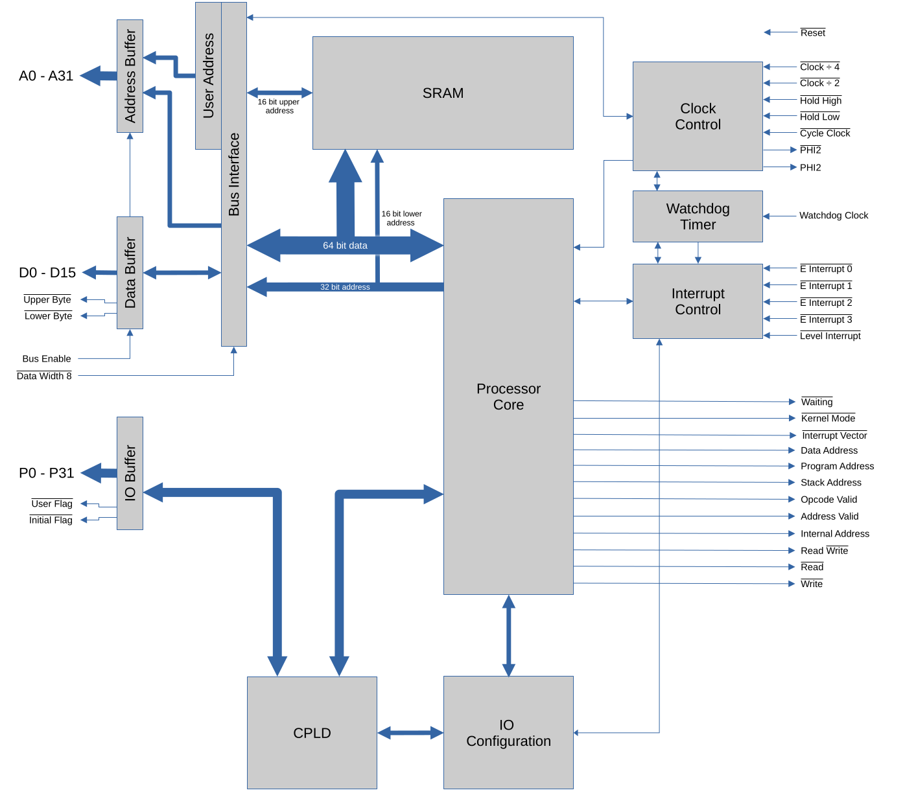
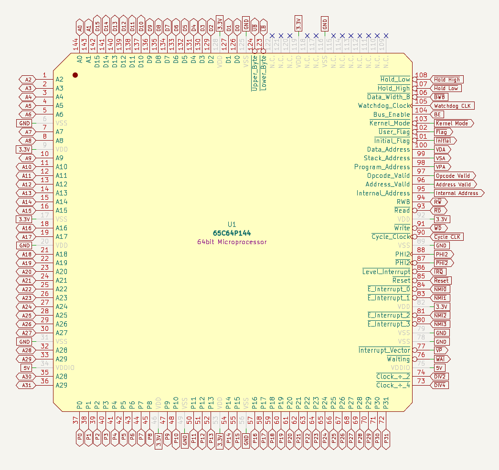

# Bus and Signals

The 65C64 has a 32 bit address bus and a 16 bit data bus.  Inside, the registers and the ALU are
64 bits wide, so a wide value crosses the bus a word at a time.

The Processor Core is largely a W65C816 with a 64 bit data path.  Around it the proposal puts a
bus interface, on-chip SRAM, clock control, a watchdog timer, interrupt control and a block of
programmable IO.

!!! note
    The simulator has the processor core, the bus and the interrupt pins.  The on-chip SRAM, the
    clock control, the watchdog, the programmable IO and the CPLD are in the proposal only.

## Bus cycles

Every bus cycle moves one aligned 16 bit word.

- The address bus carries the address of the word, so A0 is always 0.
- D0 to D7 are the byte at the even address, and D8 to D15 the byte at the odd address above
  it.  Memory is little endian.
- Lower Byte and Upper Byte say which of the two bytes the cycle transfers.  Both are low for a
  whole word, and one is low for a single byte.

Opcodes and their operand words are always aligned.  Data can be at any address and of any
width, and takes one cycle for each word it touches:

| Value | At an even address | At an odd address |
|---|---|---|
| 8 bits | 1 cycle | 1 cycle |
| 16 bits | 1 cycle | 2 cycles |
| 32 bits | 2 cycles | 3 cycles |
| 64 bits | 4 cycles | 5 cycles |

So data is best kept aligned to 16 bits.  See [Sizes and Timing](timing.md) for the cycles
each instruction takes.

In the proposal a Data Width 8 pin narrows the data bus to 8 bits for byte wide devices such
as a boot ROM.

## Signals

The signals the simulator has, with their W65C816 equivalents:

| Signal | Direction | Meaning | W65C816 |
|---|---|---|---|
| A0–A31 | Out | The address bus | A0–A15, BA0–BA7 |
| D0–D15 | Both | The data bus | D0–D7 |
| RWB | Out | High for a read, low for a write | RWB |
| Lower Byte | Out | Low when D0–D7 are transferred | |
| Upper Byte | Out | Low when D8–D15 are transferred | |
| Opcode Valid | Out | High when an opcode is being read | VPA and VDA both high |
| Program Address | Out | High when an instruction's operand words are being read | VPA |
| Data Address | Out | High when data is being read or written | VDA |
| Interrupt Vector | Out | Low when an interrupt's vector is being read | VPB |
| Cycle Clock | In | The processor clock | PHI2 |
| Reset | In | Low holds the processor in [reset](interrupts.md#reset) | RESB |
| E Interrupt 0–3 | In | A falling edge is an [edge interrupt](interrupts.md#the-interrupts) | NMIB (0) |
| Level Interrupt | In | Low is a [level interrupt](interrupts.md#the-interrupts) | IRQB |

A cycle starts when the clock falls.  The processor puts out the address and the control
signals, and for a write the data.  A read's data is taken when the clock falls again at the
end of the cycle.

## The proposal's other pins

The full proposal is a 144 pin package.  Besides the signals above it has:

| Pin | Direction | Meaning |
|---|---|---|
| Read | Out | Low for a read.  With Write, a pair of strobes for devices that want them: neither low means no bus access. |
| Write | Out | Low for a write |
| Stack Address | Out | High when the stack is being addressed |
| Address Valid | Out | High when an external address is being addressed |
| Internal Address | Out | High when the on-chip SRAM is being addressed |
| Waiting | Out | Low when the processor is stalled |
| Kernel Mode | Out | Low in [kernel mode](interrupts.md#kernel-mode-and-user-mode), high in user mode |
| PHI2, inverted PHI2 | Out | The clock the processor is actually running on, after division and holding |
| Clock ÷ 2, Clock ÷ 4 | In | Low divides the clock by 2 or by 4, and both low by 8, for slow devices |
| Hold High | In | Low stops the clock from going low, stretching the cycle (the W65C816's RDY) |
| Hold Low | In | High stops the clock from going high |
| Bus Enable | In | Low makes the address bus, the data bus, Read, Write and RWB high impedance |
| Data Width 8 | In | Low makes the data bus 8 bits wide |
| Watchdog Clock | In | The watchdog timer's clock, typically 32kHz |
| P0–P31 | Both | Programmable IO, inputs after reset |
| Initial Flag | Out | A programmable output, low after reset: it selects a boot ROM |
| User Flag | Out | A programmable output, high after reset |

## On-chip SRAM and programmable IO

A 64 bit processor on a 16 bit data bus is held back by the bus, so the proposal puts SRAM on
the chip, reached through a 64 bit internal bus: an aligned 64 bit value in one cycle.  It can be
a cache or the whole system's memory.  In the proposal's ideal form it's 16MB, the addresses
`0000:0000` to `00FF:FFFF` (see the [memory map](memory-map.md)).

The 32 programmable IO pins are inputs after reset.  An on-chip CPLD, programmed from software
through the [hardware registers](instructions/hardware.md), can make them anything a CPLD can
be: address decoding, clock stretching, a UART.

The Initial Flag is low after reset, to select a ROM at start up.  The intent is that the ROM is
copied into the on-chip SRAM and then switched off by setting the flag high.
