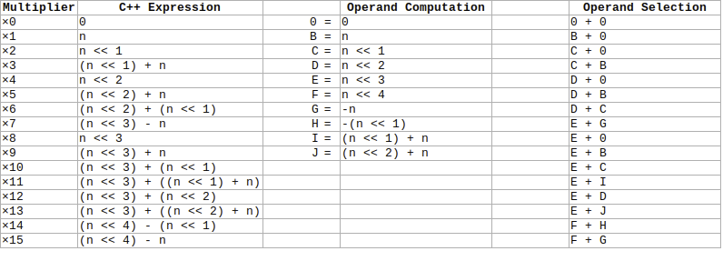

# Worked Examples

Longer programs than the instruction pages have room for.  The first part works through the
spreadsheet's multiply and divide.  The second is eleven whole programs, each written to
exercise a part of the instruction set.

## A multiply, step by step

[`mul`](instructions/multiply-divide.md#mul) multiplies A by B into Y, a byte of B each time it
runs.  This is the spreadsheet's example, `$6A8` × `$7C`:

```asm
	wtth (A, B), 16
	wth Y, 32
	cpy A, $6A8
	cpy B, $7C
	cpy W, 0
	mul			; Y = $33960
```

B is 16 bits, so the `mul` runs twice, and W counts the nybbles of B done:

| Step | W before | Byte of B | Added to Y | Y after | W after | v |
|---|---|---|---|---|---|---|
| 1 | 0 | `$7C` | `$6A8` × `$7C` = `$33960` | `$33960` | 2 | 0 |
| 2 | 2 | `$00` | 0 | `$33960` | 4 | 1: done |

The first step clears Y before it adds.  After each step C is left on the `mul`, so the
processor runs it again, until W reaches twice B's width in bytes and v is set.  Nothing is
skipped because a byte of B is zero: a 16 bit multiply is always two steps.

Inside a step the processor multiplies A by the byte a nybble at a time.  For each nybble it
picks two of a small set of shifted copies of A (n in the table) and adds them, so that no step
needs a full multiplier:



The table gives, for each value of the nybble, the two operands that are added: ×7 is A‹‹3
and -A, and ×13 is A‹‹3 and A‹‹2 + A.

## A divide, step by step

[`div`](instructions/multiply-divide.md#div) divides Y by A a nybble at a time: long division
in base 16.  Here 1000 ÷ 7 at 16 bits:

```asm
	wtth (A, B), 16
	wth Y, 16
	cpy A, 7
	cpy B, 0
	cpy Y, 1000		; $03E8
	cpy W, 0
	div			; Y = 142, B = 6
```

Each step moves the top nybble of Y into the bottom of the remainder B, takes as many 7s out
of B as will go, and moves that count into the bottom of Y as the next quotient nybble:

| Step | Nybble | B with the nybble | 7 goes | B after | Y after |
|---|---|---|---|---|---|
| 1 | `$0` | `$00` | 0 times | 0 | `$3E80` |
| 2 | `$3` | `$03` | 0 times | 3 | `$E800` |
| 3 | `$E` | `$3E` = 62 | 8 times | 6 | `$8008` |
| 4 | `$8` | `$68` = 104 | 14 times | 6 | `$008E` = 142 |

The dividend leaves Y from the top as the quotient comes in at the bottom, so Y ends as the
quotient and B as the remainder.

## Signed multiply

`mul` is unsigned.  A signed multiply takes the absolute values, multiplies, and negates the
result when the signs differed:

```asm
	.org $2000
	wtth (A, B), 32
	wtth (X, Y), 32
	cpy A, -6
	cpy B, 7
	jsr SignedMultiply	; Y = -42
	stp

SignedMultiply:
	cpy X, A
	xor X, B		; n is set when the signs differ
	stat f, n		; keep that in f
	abs A
	abs B
	cpy W, 0
	mul
	cpy W, 0		; W is 0 by the calling convention
	brac f, Done
	neg Y
Done:
	ret
```

## Add with carry

`add` has no carry in.  To add numbers wider than a register, branch on the carry out and add
it in by hand.  This adds the 128 bit number in Y:B to the one in X:A:

```asm
	.org $2000
	wtth (A, B), 64
	wtth (X, Y), 64
	cpy A, $FFFFFFFFFFFFFFFF	; the low halves
	cpy B, 1
	cpy X, 2			; the high halves
	cpy Y, 3
	add A, B			; the low halves: c is the carry out
	brac c, NoCarry
	add X, 1
NoCarry:
	add X, Y			; X:A = 6:0
	stp
```

## Whole programs

These are the assembler's feature tests.  Each is assembled and run on the simulator by
TestAssembler65Lib, and its results compared with the same calculation in C++.  Some take a
constant or their data from the test (N for the queens, the message for SHA-256), which the
comments at the top of each say.

| Program | Shows |
|---|---|
| [Sieve](#sieve) | A block fill, register widths, `mul`, absolute + register addresses |
| [Strings](#strings) | String routines that are each one block or vector instruction |
| [Queens](#queens) | Recursion, saving registers and P, `fsbi` |
| [Quicksort](#quicksort) | Recursion, register addresses, a random number generator on `mul` |
| [Base64](#base64) | Subcopy: `scp` and `scb` |
| [Bignum](#bignum) | `mul` and `div` limb by limb, a carry kept by hand |
| [Brainfuck](#brainfuck) | A jump table: `jmp [Table + X]` |
| [SHA-256](#sha-256) | Byte swaps with `scp`, rotates from shifts, an overlapping vector copy |
| [Life](#life) | Vector adds, register + register addresses |
| [Mandelbrot](#mandelbrot) | Fixed point in 64 bit registers, a signed multiply |
| [Relocate](#relocate) | Position independent code, `psh C` |

### Sieve

The primes below 10000, by the sieve of Eratosthenes.

??? example "Sieve.asm"

    ```asm
    --8<-- "Sieve.asm"
    ```

### Strings

Length, find, compare, copy, upper case and overlapping moves, each a single block or vector
instruction ended by its stop condition.

??? example "Strings.asm"

    ```asm
    --8<-- "Strings.asm"
    ```

### Queens

Counts the ways to place N queens on an N × N board with a recursive search.

??? example "Queens.asm"

    ```asm
    --8<-- "Queens.asm"
    ```

### Quicksort

Makes pseudo random numbers and sorts them in place with a recursive quicksort.

??? example "Quicksort.asm"

    ```asm
    --8<-- "Quicksort.asm"
    ```

### Base64

Encodes and decodes Base64, building and splitting each group with subcopy.

??? example "Base64.asm"

    ```asm
    --8<-- "Base64.asm"
    ```

### Bignum

100! and the 300th Fibonacci number in 32 bit limbs, printed in decimal.

??? example "Bignum.asm"

    ```asm
    --8<-- "Bignum.asm"
    ```

### Brainfuck

A Brainfuck interpreter that dispatches through a jump table.

??? example "Brainfuck.asm"

    ```asm
    --8<-- "Brainfuck.asm"
    ```

### SHA-256

The SHA-256 digest of a message, checked against the FIPS test vectors.

??? example "Sha256.asm"

    ```asm
    --8<-- "Sha256.asm"
    ```

### Life

Conway's Game of Life, counting each row's neighbours with vector adds.

??? example "Life.asm"

    ```asm
    --8<-- "Life.asm"
    ```

### Mandelbrot

The Mandelbrot set in Q24 fixed point, a pixel at a time.

??? example "Mandelbrot.asm"

    ```asm
    --8<-- "Mandelbrot.asm"
    ```

### Relocate

A loader that copies a position independent payload and runs it at its new address.

??? example "Relocate.asm"

    ```asm
    --8<-- "Relocate.asm"
    ```
