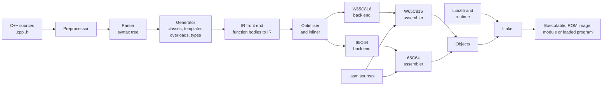

# HCP65 C++ Compiler

The HCP65 tool chain compiles C++ for two processors: the **W65C816**, the HCP65 computer's own
processor, and the **65C64**, the [64 bit processor proposal](../65c64/index.md).  It is a
C++ compiler, an assembler for each processor, one linker, and Libc65, the C library and
runtime the compiled code calls.

## The parts

| Part | Where | What it does |
|---|---|---|
| C++ compiler | `CommonLibraries/Libraries/CppCompilerLib` | Preprocesses, parses and type checks C++, turns it into an intermediate representation (IR), optimises that and writes assembly for either processor. |
| Assemblers | `HCP65/Libraries/Assembler65Lib` | `CAsmW65C816Assembler` and `CAsm65C64Assembler`: the same source format and directives, each processor's own instructions. |
| Linker | `HCP65/Libraries/Assembler65Lib` | `CAsm65Linker`: one object format and one linker for both processors.  Writes executables, ROM images and relocatable modules. |
| Libc65 | `HCP65/Libraries/Libc65` | The C standard headers and library, soft float, the maths library and the W65C816's runtime routines. |
| `hcp65build` | `HCP65-IDE/HCP65Build` | The command line build tool.  The HCP65 IDE builds the same way from inside the editor. |

The library was called CppParserLib until November 2026: it started as a C++ parser for
syntax highlighting and grew into the compiler.

## What it compiles

The compiler takes a large subset of C++14: classes with multiple inheritance and virtual
functions, templates (with partial specialisation and variadic templates), overloading,
operators, references and namespaces.  Exceptions, lambdas and `auto` are not supported yet.
The measure of how much is supported is the project's own libraries: all of BaseLib,
StandardLib and SupportLib compile for both processors, and their test suites run on the
emulators.  [Supported C++](language.md) has the details.

The two processors are very different targets:

| | W65C816 | 65C64 |
|---|---|---|
| `int` | 16 bits | 32 bits |
| `long`, pointers, `size_t` | 32 bits | 32 bits |
| Registers | A, X and Y, 16 bits; the direct page is the frame | A, B, X, Y, 32 bits (64 for `long long`); 256 bytes of pseudo registers |
| Multiply and divide | Runtime routines | Instructions |
| Floating point | Soft float in assembly | Soft float in assembly |
| Calls | `jsl` / `rtl`, arguments in A, X and Y where they fit | `jsr` / `ret`, arguments pushed |

## Pages

- [Building Programs](building.md): `hcp65build`, its build configurations and what it writes.
- [Supported C++](language.md): the language, the types on each processor, the extensions and what isn't supported.
- [Inside the Compiler](inside.md): the stages from source text to assembly.
- [Intermediate Representation](ir.md): the IR, its text form and the optimiser's passes.
- [W65C816 Code](w65c816.md): the W65C816 back end, its calling convention, frames and runtime.
- [65C64 Code](65c64.md): the 65C64 back end.
- [W65C816 Assembler](assembler-w65c816.md): the W65C816 assembler's source format.
- [Linker and Outputs](linker.md): linking for both processors, and the files a link writes.
- [Libc65](libc65.md): the C library both processors use.
- [Listings, Profiling and Testing](testing.md): seeing what the compiler wrote, measuring it, and the test suites.

The 65C64 assembler and the object format are described with the processor:
[Assembler](../65c64/assembler.md), [Objects and Linking](../65c64/linking.md) and
[Calling Convention](../65c64/calling-convention.md).
